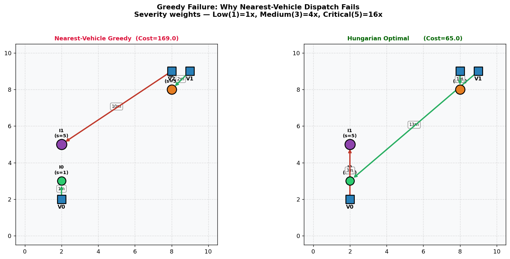
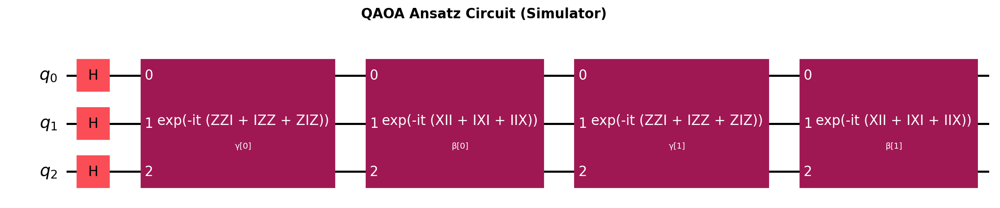
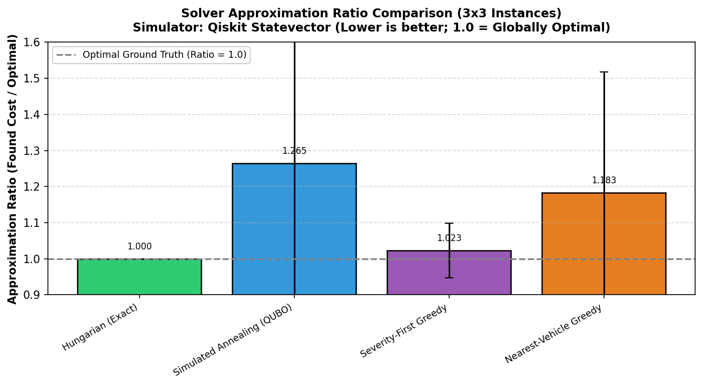
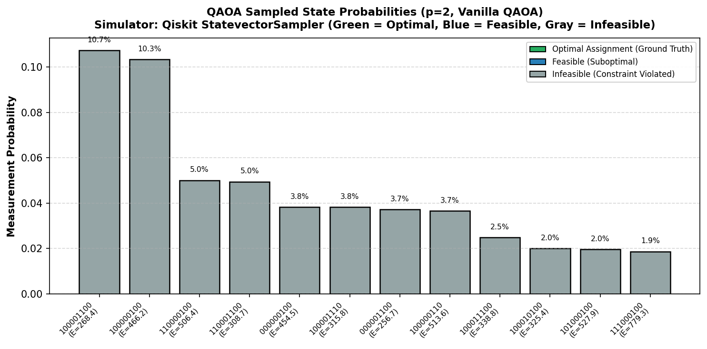
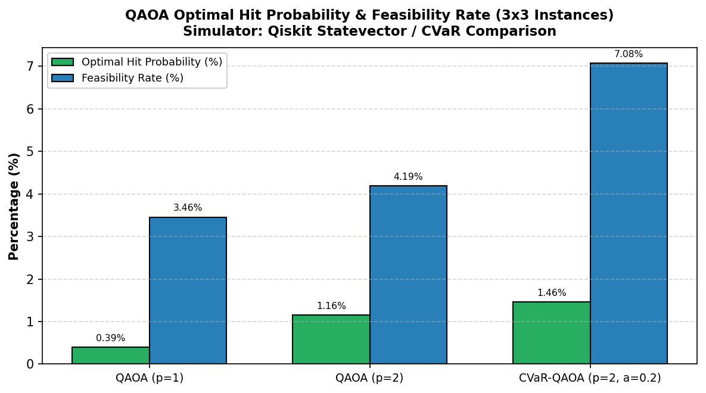
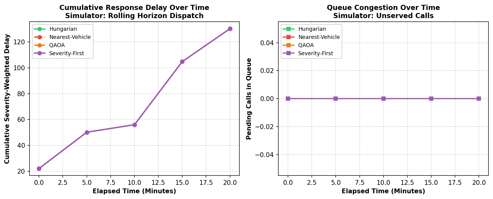

# Severity-Aware Emergency Dispatch Using QAOA

**IBM Qiskit Fall Fest 2026 – RV University | 24-hour Online Hackathon**

> A QUBO + QAOA pipeline that formulates severity-weighted ambulance assignment as a quantum optimization problem and benchmarks it against classical solvers on a Qiskit statevector simulator.

---

## The Problem: Why Nearest-Vehicle Dispatch Fails

Emergency dispatch typically sends the closest available ambulance. But when several incidents compete for few vehicles, this greedy strategy can leave a **critical patient waiting** while a nearby ambulance rushes to a minor call.



*Figure: The nearest-vehicle heuristic (left) assigns the closest ambulance to a low-severity call, leaving the critical patient to wait. The optimal assignment (right) prioritizes severity.*

### Our Question

> **How can a limited ambulance fleet be assigned to incidents so that severity-weighted response time is minimized, while each vehicle serves exactly one incident?**

We formulate this as a **Quadratic Unconstrained Binary Optimization (QUBO)** problem, convert it to an **Ising Hamiltonian**, and solve it with **QAOA** using Qiskit. We benchmark against exact and heuristic classical solvers.

---

## Approach

### 1. Problem Model

| Symbol | Meaning |
|--------|---------|
| `v = 0..n-1` | Vehicles (ambulances), each at a grid position |
| `i = 0..m-1` | Incidents, each with severity `s_i ∈ {1..5}` |
| `t[v][i]` | Manhattan travel time from vehicle `v` to incident `i` |
| `w_i` | Severity weight: `{1:1, 2:2, 3:4, 4:8, 5:16}` |
| `c[v][i] = w_i × t[v][i]` | Cost of assigning vehicle `v` to incident `i` |
| `x[v,i] ∈ {0,1}` | Binary variable: 1 if vehicle `v` goes to incident `i` |

**Objective:** minimize `Σ c[v,i] · x[v,i]`

### 2. QUBO Formulation

After padding to a square N×N problem (dummy vehicles or dummy incidents):

```
H(x) = Σ c[v,i] x[v,i]
      + P · Σ_v (Σ_i x[v,i] - 1)²     ← each vehicle assigned exactly once
      + P · Σ_i (Σ_v x[v,i] - 1)²     ← each incident served exactly once
```

- Penalty weight `P = 1.5 × max(c)` is chosen to make infeasible states costlier than feasible ones; the QUBO minimum was verified to be feasible on every test instance.
- Expanded into an N²×N² matrix Q so `H(x) = xᵀQx + offset`.
- **Validated:** brute-force minimum of Q equals the Hungarian algorithm optimum on every test instance.

### 3. Ising Hamiltonian

Substitute `x_k = (I - Z_k)/2` to convert QUBO into a sum of Pauli operators:

```
H_Ising = Σ h_k Z_k + Σ_{k<l} J_{kl} Z_k Z_l + c·I
```

Built as a Qiskit `SparsePauliOp`. Diagonal values match QUBO energies for all bitstrings ✓

### 4. QAOA Circuit

```
|ψ₀⟩ = |+⟩^⊗N  (uniform superposition)

For layer ℓ = 1..p:
  Apply cost unitary:  exp(-iγ_ℓ H_C)   [encodes problem]
  Apply mixer unitary: exp(-iβ_ℓ Σ X_k) [explores solution space]

Measure → decode → select best feasible bitstring
```



*Figure: QAOA ansatz circuit (p=2) — 3-qubit illustrative circuit for visualization (the full 3×3 dispatch problem uses 9 qubits). Qiskit Statevector Simulator.*

- **Optimizer:** COBYLA with 1–3 random restarts per instance (2 for the 3×3 benchmark, 1 for 4×4, 3 for the showcase run)
- **Depth:** p = 1, 2 (random initial parameters; warm-starting is listed under Future Work)
- **CVaR variant:** optimizes the mean of the best α=20% fraction of samples

---

## Quick Start

```bash
git clone https://github.com/shrisha77-boop/Severity-Aware-Emergency-Dispatch-Using-QAOA.git
cd Severity-Aware-Emergency-Dispatch-Using-QAOA
python -m venv .venv
.venv\Scripts\activate        # Windows
# source .venv/bin/activate  # Linux/Mac
pip install -r requirements.txt
python run_all.py --quick     # quick run (~30 sec); overwrites the CSVs in results/ with a smaller run
python run_all.py             # regenerates all figures and tables (~10 min)
```

**Launch interactive Streamlit dashboard:**
```bash
python -m streamlit run frontend/app.py
```
*Open [http://localhost:8501](http://localhost:8501) in your browser.*

**Run just the tests:**
```bash
pytest tests/ -v
```

---

## Repository Map

```
Severity-Aware-Emergency-Dispatch-Using-QAOA/
├── README.md
├── requirements.txt
├── run_all.py               ← one command to reproduce everything
├── data/
│   └── instance.py          ← generate_instance(), generate_greedy_failure_instance()
├── model/
│   ├── qubo.py              ← build_qubo(), validate_qubo_energy()
│   └── ising.py             ← qubo_to_ising() -> SparsePauliOp
├── solvers/
│   ├── exact.py             ← solve_hungarian(), solve_brute_force_qubo()
│   ├── greedy.py            ← solve_nearest_vehicle(), solve_severity_first_greedy()
│   ├── sa.py                ← solve_simulated_annealing() (QUBO, geometric cooling)
│   └── qaoa.py              ← run_qaoa() with CVaR option, circuit diagram, plots
├── frontend/
│   ├── app.py               ← Interactive Streamlit dashboard (Dark Theme)
│   ├── components/          ← Tab views: Scenario, Assignments, Comparison, Quantum Lab
│   └── services/            ← dispatch_service.py bridge to backend solvers
├── experiments/
│   ├── benchmark.py         ← run_benchmarks() → results/benchmark.csv
│   ├── penalty_sweep.py     ← penalty P sensitivity analysis
│   └── dynamic_sim.py       ← rolling-horizon dynamic dispatch simulation
├── figures/                 ← generated PNGs (committed)
├── results/                 ← generated CSVs (committed)
├── notebooks/
│   └── walkthrough.ipynb    ← step-by-step interactive demo
└── tests/
    └── test_qubo.py         ← QUBO min == Hungarian on 20 random instances
```

---

## Results

> **All results are from a classical Qiskit Statevector Simulator. No real quantum hardware was used.**

### Approximation Ratio Comparison (3×3, 30 instances)



| Solver | Mean Approx Ratio | Optimal Hit % | Feasibility % | Notes |
|--------|:-----------------:|:-------------:|:-------------:|-------|
| Hungarian (Exact) | **1.0000** | 100.0% | 100.0% | Global optimum (ground truth baseline) |
| Severity-First Greedy | **1.0227** | 70.0% | 100.0% | Strong classical heuristic |
| CVaR-QAOA (p=2, α=0.2) | **1.0441** | 1.46% | 7.08% | Best quantum variant (tail energy optimization) |
| QAOA (p=1) | **1.0655** | 0.39% | 3.46% | Average approx ratio slightly lower than p=2 |
| QAOA (p=2) | **1.0768** | 1.16% | 4.19% | Triples optimal-hit probability over p=1 (0.39% → 1.16%) |
| Nearest-Vehicle Greedy | **1.1830** | 46.7% | 100.0% | Suboptimal — ignores incident severity weights |
| Simulated Annealing (QUBO) | **1.2647** | 36.7% | 100.0% | Worst solver — trapped in QUBO penalty landscape |

### QAOA Probability Distribution



*Figure: Top ~12 sampled bitstrings from QAOA (9-qubit, p=2, 4096 shots). Gray bars indicate infeasible bitstrings (the standard unconstrained X-mixer explores all 2⁹ Hilbert states; optimal feasible assignments reside in the distribution tail; mean optimal-hit probability is ~1.16% across 30 instances, ~0.58% for the plotted instance). Qiskit Statevector Simulator.*

### QAOA Optimal-Hit Probability & Feasibility Rate



### Dynamic Dispatch (Rolling Horizon)



*Figure: Cumulative severity-weighted delay over rolling time windows. Each solver makes local assignments per window; likely because myopic per-window assignments relocate ambulances differently for future call arrivals, long-term trajectories vary (QAOA and Severity-First finished at 487.5 cumulative delay vs. Hungarian's 532.9 and Nearest-Vehicle's 520.0). Qiskit Statevector Simulator.*

---

## Honest Limitations

1. **Assignment is polynomial.** One-to-one assignment is solved exactly in O(N³) by the Hungarian algorithm. Classical exact methods strictly dominate QAOA on this base problem.

2. **Simulator only.** QAOA ran on a Qiskit Statevector Simulator (9 and 16 qubits). Results say nothing about performance on real hardware or at quantum-advantage scale.

3. **X-mixer violates constraints.** The standard QAOA X-mixer explores infeasible states. A share of samples is infeasible (constraint not satisfied); feasibility rate < 100% especially at p=1.

4. **Optimization sensitivity.** COBYLA is sensitive to initialization and penalty weight. Results are averaged over a limited number of random restarts and instances.

5. **Synthetic grid.** Travel times use Manhattan distance on a synthetic city grid. Real traffic, road networks, hospital capacity, and multi-incident routing are not modelled.

6. **Qubit scaling.** Qubit count grows as N², so this approach does not scale to city-size fleets without decomposition or embedding tricks.

**Why we do it anyway:** this pipeline is a correct, validated, extensible QUBO + QAOA foundation for harder dispatch variants (multi-routing, capacity limits, VRP) that *are* NP-hard.

---

## What We Wrote vs. What We Reused

| Component | Source |
|-----------|--------|
| `QAOAAnsatz`, `SparsePauliOp`, `StatevectorEstimator`, primitives | Qiskit (IBM Quantum) |
| `linear_sum_assignment` (Hungarian) | SciPy |
| COBYLA optimizer | SciPy |
| QUBO construction & validation | Written by Shrisha |
| Ising conversion (manual numpy + cross-check) | Written by Shrisha |
| Simulated annealing (QUBO, geometric cooling) | Written by Shrisha |
| Greedy dispatch heuristics | Written by Shrisha |
| Benchmark harness, penalty sweep, dynamic simulation | Written by Shrisha |
| Interactive Streamlit dashboard & visualization | Written by Shrisha |
| CVaR objective implementation | Adapted from Barkoutsos et al. (2020) |

---

## References

- Farhi, Goldstone, Gutmann, "A Quantum Approximate Optimization Algorithm", [arXiv:1411.4028](https://arxiv.org/abs/1411.4028) (2014)
- Lucas, "Ising formulations of many NP problems", [Frontiers in Physics 2, 5](https://doi.org/10.3389/fphy.2014.00005) (2014)
- Barkoutsos et al., "Improving Variational Quantum Optimization using CVaR", [Quantum 4, 256](https://doi.org/10.22331/q-2020-04-20-256) (2020)
- [Qiskit Documentation](https://docs.quantum.ibm.com)
- [SciPy `linear_sum_assignment`](https://docs.scipy.org/doc/scipy/reference/generated/scipy.optimize.linear_sum_assignment.html)

---

## Team

- **Shrisha** — Solo Developer
  - Mathematical modeling & severity weighting
  - QUBO formulation, penalty weight tuning, and Ising Hamiltonian mapping
  - QAOA & CVaR-QAOA implementation using Qiskit primitives and COBYLA optimization
  - Classical baseline implementations (Hungarian algorithm, Greedy heuristics, Simulated Annealing)
  - Benchmarking harness, penalty sweep, and dynamic rolling-horizon simulation
  - Interactive Streamlit visualization dashboard, test suite, and documentation
- *IBM Qiskit Fall Fest 2026 — RV University*

**Future Work:** warm-starting QAOA layers, XY-mixer to preserve feasibility constraints, Grover mixer, noise-model simulation, real IBM hardware run, decomposition for larger fleets, multi-routing VRP extensions.
